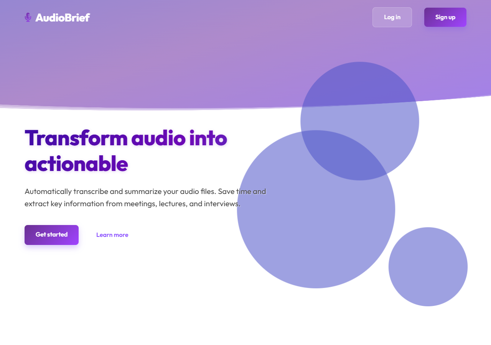
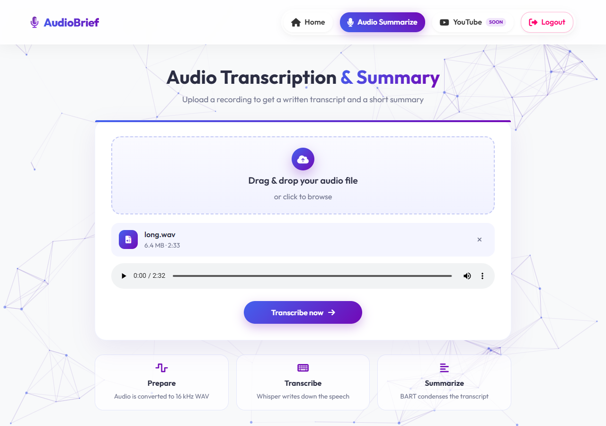
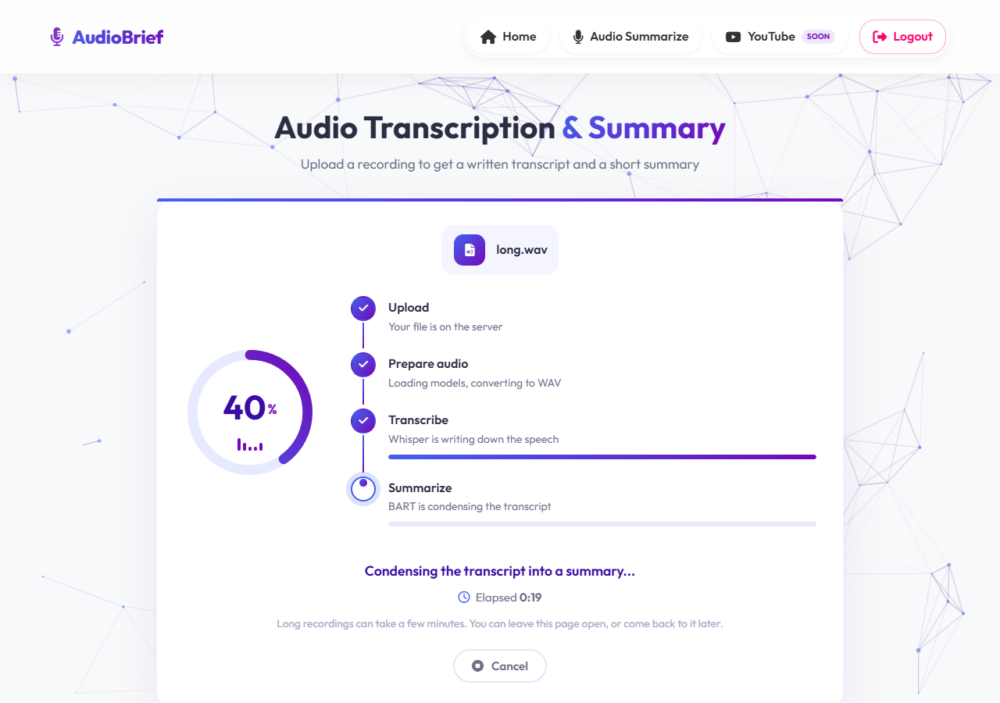
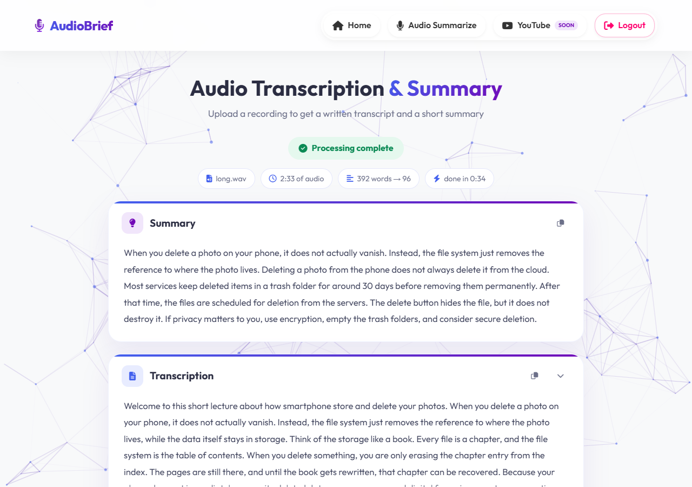
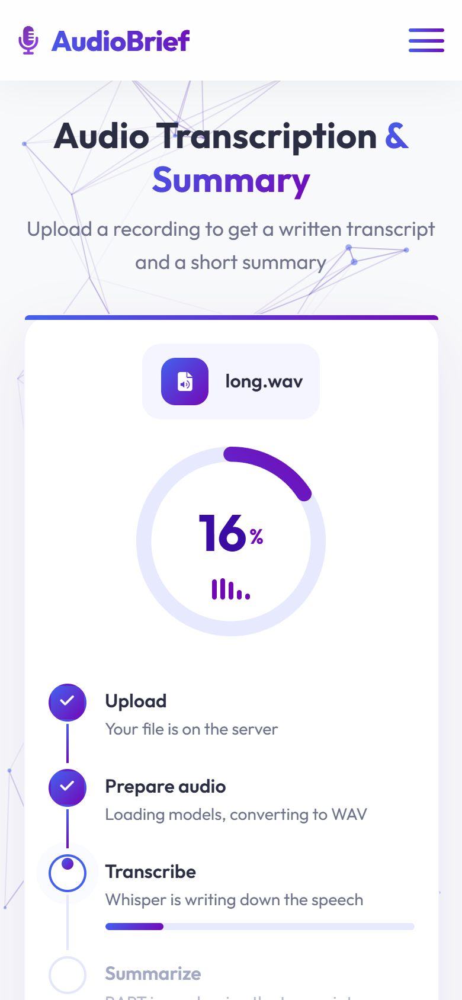
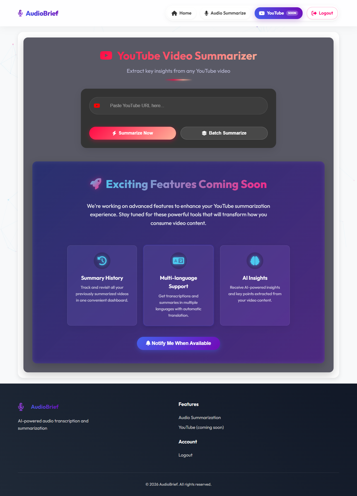
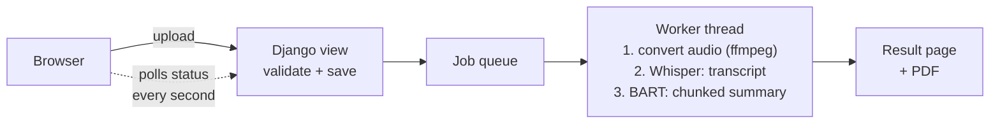

<h1 align="center">AudioBrief</h1>

<p align="center">
  <strong>Turn a recording into a transcript and a summary.</strong><br>
  A Django web app that combines <b>OpenAI Whisper</b> (speech-to-text) and <b>Facebook BART</b> (summarization),<br>
  with a background job queue and a <b>real, live progress screen</b>.
</p>

<p align="center">
  
  
  
  <a href="LICENSE"></a>
</p>

<p align="center">
  
</p>

## What it does

1. **Upload** a recording (MP3, WAV, M4A, OGG, FLAC or AAC, up to 100 MB).
2. **Watch it being processed** - a progress ring and step list show what is happening right now, with a Cancel button.
3. **Read** a short summary and the full transcript, **copy** them, or **download a PDF**.

Useful for lectures, meetings, interviews and podcasts. English audio.

## Why it is interesting (engineering highlights)

| Problem | What I built |
|---|---|
| A 2-minute file takes a while to process; a normal request would freeze the page | A **background worker thread with a job queue**. The upload returns instantly and the page polls a small JSON endpoint. Jobs can be cancelled, and each user can only see their own jobs. |
| Progress bars usually lie (fake timers) | **Real progress**: Whisper's internal progress bar is hooked and turned into a callback; BART progress is counted per chunk; the upload bar comes from the browser's `XMLHttpRequest`. |
| BART can only read 1024 tokens, so long recordings would be cut off | **Chunked summarization**: the transcript is split into sentence-aligned chunks, each is summarized, and the parts are joined (or reduced again if still too long). Nothing is dropped. |
| Models are ~1.8 GB and slow to load | **Lazy, thread-safe loading** (preloaded in the background when the server starts), with CUDA-to-CPU fallback. |
| Real users upload bad files | Corrupt files, silent audio, wrong formats and oversized uploads each produce a clear message; temp files are **always deleted**, even on failure or cancel. |

## Screenshots

| Landing page | Upload |
|:---:|:---:|
|  |  |

| Live progress | Result |
|:---:|:---:|
|  |  |

| On a phone | Planned: YouTube summaries (front-end preview only) |
|:---:|:---:|
|  |  |

## How it works



The full design, sequence diagram, job state machine and trade-offs are in **[docs/ARCHITECTURE.md](docs/ARCHITECTURE.md)**.

## Tech stack

| Area | Technology |
|---|---|
| Backend | Python 3.10+, Django 5.2 |
| Speech-to-text | OpenAI Whisper (`openai-whisper`, PyTorch) |
| Summarization | `facebook/bart-large-cnn` (Hugging Face Transformers) |
| Audio | pydub + ffmpeg |
| PDF | ReportLab |
| Database | SQLite by default, MySQL optional (user accounts only) |
| Frontend | Django templates, HTML, CSS, vanilla JavaScript |

## Getting started

**You need:** Python 3.10-3.12, **ffmpeg**, about 3 GB of disk and an internet connection for the first run (the AI models, ~1.8 GB, download automatically once), and 8 GB of RAM or more.

```bash
git clone https://github.com/Sana-nas/audio-brief.git
cd audio-brief

python -m venv .venv
# Windows PowerShell:  .\.venv\Scripts\Activate.ps1      (if blocked: Set-ExecutionPolicy -Scope Process Bypass)
# macOS / Linux:       source .venv/bin/activate

pip install -r requirements.txt
python manage.py migrate
python manage.py runserver
```

Open **http://127.0.0.1:8000/**, sign up, choose **Audio Summarize** and upload a file. The first start takes a few minutes because of the model download; later starts take 10-30 seconds.

<details>
<summary>Installing ffmpeg</summary>

* Windows: `winget install Gyan.FFmpeg` (then reopen the terminal)
* macOS: `brew install ffmpeg`
* Linux: `sudo apt install ffmpeg`

Check with `ffmpeg -version`.
</details>

> **Speed:** on a laptop CPU, processing takes roughly a quarter to a half of the recording's length (a 2.5-minute file took about 35 seconds on the development machine). A CUDA GPU is used automatically if available.

To manage users, run `python manage.py createsuperuser` and open `/admin/`.

## Configuration

All optional; the defaults work for local development.

| Variable | Default | Meaning |
|---|---|---|
| `WHISPER_MODEL` | `base` | `tiny` (fastest), `base`, `small`, `medium`, `large` (most accurate, slowest) |
| `DJANGO_DEBUG` | `1` | `0` turns debug off (then also set `DJANGO_ALLOWED_HOSTS`) |
| `DJANGO_ALLOWED_HOSTS` | empty | Comma-separated host names |
| `DB_ENGINE` | `sqlite` | `mysql` to use MySQL (also `DB_NAME`, `DB_USER`, `DB_PASSWORD`, optional `DB_HOST`, `DB_PORT`; `pip install mysqlclient`) |

## Project structure

```
manage.py
requirements.txt
speech_app/                   Django project (settings, URLs)
core/
  views.py                    thin HTTP layer
  auth.py  middleware.py      login-required rules
  services/                   ai_models, audio, transcription, summarization, pdf, jobs
  templatetags/               nav_tags (active menu item), assets (cache-busting URLs)
templates/core/               layout, landing, home, transcribe, youtube, login, register
static/                       css, js, images
docs/                         ARCHITECTURE.md, demo.gif, screenshots
```

## Limitations and roadmap

* English audio only; results are kept in memory for an hour (not saved per user); jobs run one at a time in a single server process. The reasoning is in [ARCHITECTURE.md](docs/ARCHITECTURE.md#6-trade-offs-and-known-limitations).
* **Planned:** YouTube link summaries (the page is a front-end preview), saved history per user, speaker labels, more export formats (TXT/DOCX), a choice of summary length, and Celery + Redis for jobs.

## License

Released under the [MIT License](LICENSE).

## Author

Built by **Sana Anas K** - [@Sana-nas](https://github.com/Sana-nas).
