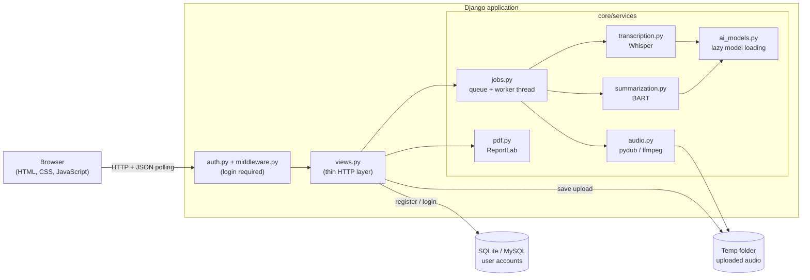
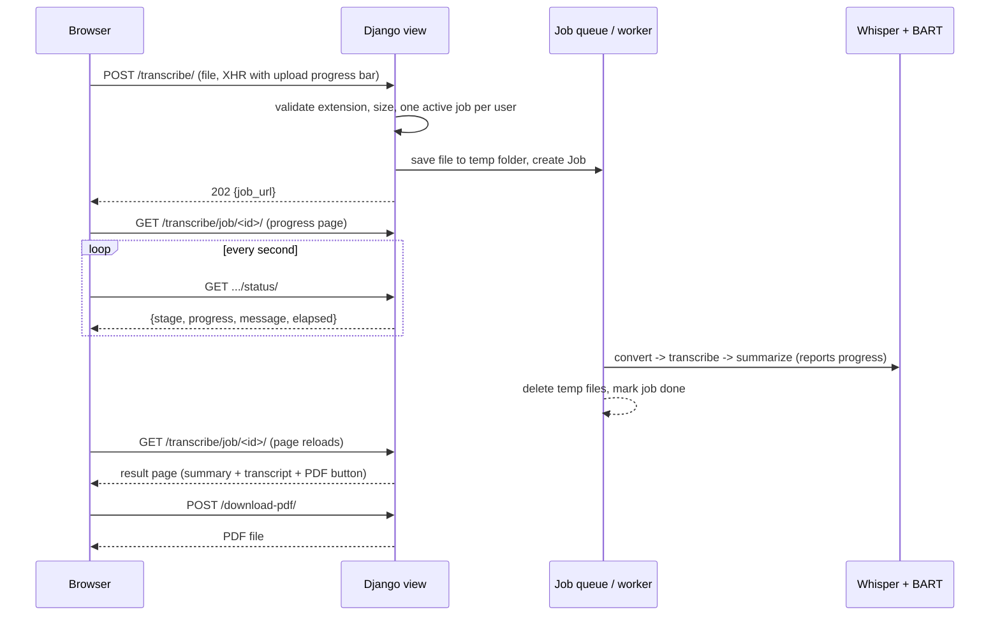
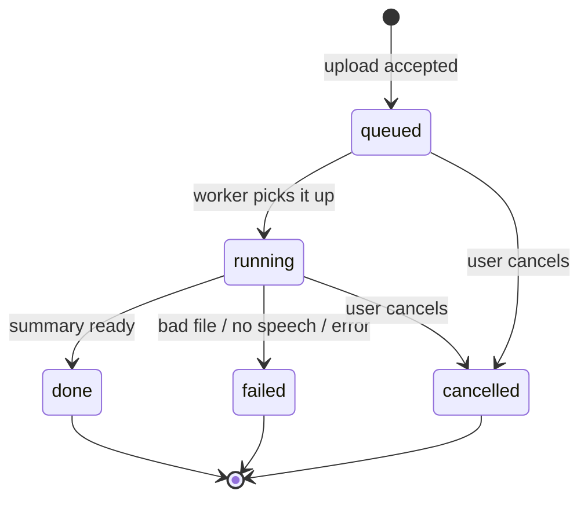

# Architecture

This document explains how AudioBrief is built and why. For setup instructions see the [README](../README.md).

## 1. Big picture

* **Frontend** - server-rendered Django templates, plain CSS and vanilla JavaScript (no framework).
* **Views** - validate input, talk to the services, return HTML or JSON. They contain no AI code.
* **Services** - all the real work. Each file has one job and can be used without a web request.
* **Database** - only user accounts and sessions (Django's built-in auth). Results are *not* stored; see "Trade-offs".

## 2. What happens when a user uploads a file

## 3. Job life cycle

While `running`, a job moves through these **stages**, each reporting real progress:

| Stage | What happens | Overall bar |
|-------|--------------|-------------|
| `loading` | Load Whisper + BART (only if not loaded yet) | 0 - 5 % |
| `converting` | pydub/ffmpeg converts the file to 16 kHz mono WAV | 5 - 10 % |
| `transcribing` | Whisper; progress = audio windows processed / total | 10 - 40 % |
| `summarizing` | BART; progress = chunks summarized / total chunks | 40 - 100 % |

## 4. Modules

| File | Responsibility |
|------|----------------|
| `core/views.py` | Pages, login/registration, upload endpoint, job page/status/cancel, PDF download |
| `core/auth.py`, `core/middleware.py` | `login_required` decorator and a middleware that redirects anonymous users (only landing, login and register are public) |
| `core/services/ai_models.py` | Loads Whisper and BART once, on first use or in the background when the server starts; CUDA -> CPU fallback |
| `core/services/audio.py` | Converts any supported file to 16 kHz mono WAV |
| `core/services/transcription.py` | Runs Whisper and turns its internal progress bar into a callback |
| `core/services/summarization.py` | Splits long text into sentence-aligned chunks, summarizes each with BART, joins (or reduces again) |
| `core/services/jobs.py` | `Job` data class, `JobManager`, the queue and the single worker thread, cancellation, cleanup |
| `core/services/pdf.py` | Builds the PDF report |
| `templates/core/` | `layout.html` (shell for logged-in pages), `landing.html`, `home.html`, `transcribe.html` (upload / progress / result / error), `youtube.html` (coming-soon preview), `login.html`, `register.html` |
| `static/js/transcribe.js` | Upload with progress, polling and the progress ring, copy buttons |

## 5. Design decisions

**Whisper for speech-to-text.** An encoder-decoder Transformer trained on 680,000 hours of audio. It copes well with accents and background noise, runs locally and is open source. The default size is `base` (fast, decent accuracy); `small`/`medium` are more accurate but slower (`WHISPER_MODEL` environment variable).

**BART (`facebook/bart-large-cnn`) for summaries.** An *abstractive* model: it writes new sentences rather than copying existing ones. It can only read 1024 tokens at once, so long transcripts are split into chunks of ~350 words (whole sentences), each chunk is summarized, and the partial summaries are joined. If the joined text is still too long, one more reduction pass is made. Nothing is silently cut off.

**Deterministic decoding.** Beam search without sampling, and a summary length proportional to the input. An earlier version forced a minimum length of 600 tokens, which made the model invent sentences for short recordings.

**Background job instead of doing the work inside the request.** A two-minute recording needs tens of seconds of CPU time. Blocking the HTTP request freezes the page and risks a server timeout. A background worker lets the page show real progress and offer a Cancel button.

**One worker thread.** The models use all CPU cores, so running jobs in parallel would just make each slower. Additional uploads wait in the queue ("N jobs ahead of you"). Each user may have one active job at a time.

**Real progress, not a fake timer.** Whisper advances an internal `tqdm` bar per 30-second window; `transcription.py` swaps it for a subclass that also calls our callback. BART progress is counted in chunks. Uploading uses `XMLHttpRequest`'s real `upload.onprogress`. Cancelling works by raising an exception from inside these callbacks.

**Lazy model loading.** The models are ~1.8 GB. Loading them when Django imports the code made `manage.py migrate` slow. They now load on first use, or in a background thread when `runserver` starts.

**Security basics.** CSRF protection on all forms and AJAX calls, Django's password hashing and validators, jobs are only visible to their owner, all transcript text is HTML-escaped (and XML-escaped in the PDF), uploads are checked for extension and size, uploaded files are stored in the temp folder and deleted after processing, and passwords are never logged.

## 6. Trade-offs and known limitations

* **Jobs live in memory.** Results disappear after one hour or when the server restarts, and this only works with a single server process. This avoids extra database tables for an academic project. In production the same `jobs.py` interface could be backed by Celery + Redis and a database table.
* **English only.** Whisper is told `language="en"` and BART-large-cnn is an English model.
* **CPU speed.** Summarization is the slow part; a GPU (CUDA) makes it much faster and is used automatically if available.
* **Lead bias.** BART-cnn was trained on news articles and tends to favour the beginning of each chunk, so a chunk that jumps between topics may lose the later ones.
* **No speaker separation, no history, no YouTube support.** These are planned enhancements; the YouTube page is a front-end preview only.
